# MiWiFi for Home Assistant
[](https://github.com/hacs/integration)
[](https://github.com/JuanManuelRomeroGarcia/hass-miwifi/actions/workflows/validate.yml)
[](https://t.me/XiaohackRouters)


> **Help test Xiaomi router compatibility / Ayuda a comprobar tu router**
>
> Run the optional PC tools and share reviewed reports in [Discussion #374](https://github.com/JuanManuelRomeroGarcia/hass-miwifi/discussions/374). No test integration installation is required.
>
> Ejecuta las herramientas voluntarias desde el PC y comparte los informes revisados en la discusión. No hace falta instalar una integración de prueba.
>
> [English guide](https://github.com/JuanManuelRomeroGarcia/hass-miwifi/wiki/Router-API-community) · [Guía en español](https://github.com/JuanManuelRomeroGarcia/hass-miwifi/wiki/Router-API-community-es)

The component allows you to monitor devices and manage routers based on [MiWiFi](http://miwifi.com/) from [Home Assistant](https://www.home-assistant.io/).


❗ Supports routers with original or original patched MiWifi firmware


❗ On the modified firmware, not all functionality may work


## More info
- [Install](https://github.com/JuanManuelRomeroGarcia/hass-miwifi/wiki/Install)
- [Config](https://github.com/JuanManuelRomeroGarcia/hass-miwifi/wiki/Config)
  - [Advanced config](https://github.com/JuanManuelRomeroGarcia/hass-miwifi/wiki/Config#advanced-config)
    - [Automatically remove devices](https://github.com/JuanManuelRomeroGarcia/hass-miwifi/wiki/Config#automatically-remove-devices)
- [Supported routers](#supported-routers)
  - [Summary](#summary)
  - [Check list](#check-list)
    - [Required](#required)
    - [Additional](#additional)
    - [Action](#action)
- [Home Assistant compatibility](#home-assistant-compatibility)
- [Conflicts](https://github.com/JuanManuelRomeroGarcia/hass-miwifi/wiki/Conflicts)
- [Entities](https://github.com/JuanManuelRomeroGarcia/hass-miwifi/wiki/Entities)
- [Services](https://github.com/JuanManuelRomeroGarcia/hass-miwifi/wiki/Services)
  - [Calculate passwd](https://github.com/JuanManuelRomeroGarcia/hass-miwifi/wiki/Services#calculate-passwd)
  - [Send request](https://github.com/JuanManuelRomeroGarcia/hass-miwifi/wiki/Services#send-request)
- [Events](https://github.com/JuanManuelRomeroGarcia/hass-miwifi/wiki/Events)
  - [Luci response](https://github.com/JuanManuelRomeroGarcia/hass-miwifi/wiki/Events#luci-response)
- [Performance table](https://github.com/JuanManuelRomeroGarcia/hass-miwifi/wiki/Performance-table)
- [Example automation](https://github.com/JuanManuelRomeroGarcia/hass-miwifi/wiki/Example-automation)
  - [Device blocking](https://github.com/JuanManuelRomeroGarcia/hass-miwifi/wiki/Example-automation#device-blocking)
  - [Lighting automation](https://github.com/JuanManuelRomeroGarcia/hass-miwifi/wiki/Example-automation#lighting-automation)
- [Diagnostics](https://github.com/JuanManuelRomeroGarcia/hass-miwifi/wiki/Diagnostics)
  - [Mesh support capture](https://github.com/JuanManuelRomeroGarcia/hass-miwifi/wiki/Mesh-support-capture)
  - [Mesh node identities and dashboard filters](https://github.com/JuanManuelRomeroGarcia/hass-miwifi/wiki/Mesh-client-routing)
    - [Guía en español](https://github.com/JuanManuelRomeroGarcia/hass-miwifi/wiki/Mesh-client-routing-es)
- [FAQ](https://github.com/JuanManuelRomeroGarcia/hass-miwifi/wiki/FAQ)
- [Private MAC addresses and automatic replacement](https://github.com/JuanManuelRomeroGarcia/hass-miwifi/wiki/Random-MAC-addresses) (v3.9.0)
  - [Guía en español](https://github.com/JuanManuelRomeroGarcia/hass-miwifi/wiki/Random-MAC-addresses-es)
- [DHCP reservations](https://github.com/JuanManuelRomeroGarcia/hass-miwifi/wiki/DHCP-reservations) (v3.10.0)
  - [Guía en español](https://github.com/JuanManuelRomeroGarcia/hass-miwifi/wiki/DHCP-reservations-es)
- [Authentication security and CodeQL findings](https://github.com/JuanManuelRomeroGarcia/hass-miwifi/wiki/Authentication-security)
  - [Guía en español](https://github.com/JuanManuelRomeroGarcia/hass-miwifi/wiki/Authentication-security-es)
- [Panel cards, lists and configurable device tables](https://github.com/JuanManuelRomeroGarcia/hass-miwifi/wiki/Panel-device-view) (v3.11.0)
  - [Guía en español](https://github.com/JuanManuelRomeroGarcia/hass-miwifi/wiki/Panel-device-view-es)
- [BE6500 Pro / RD08 client categories and dual WAN](https://github.com/JuanManuelRomeroGarcia/hass-miwifi/wiki/BE6500-Pro) (v3.11.0)
  - [Guía en español](https://github.com/JuanManuelRomeroGarcia/hass-miwifi/wiki/BE6500-Pro-es)


- [Mesh settings, manual AP role and safe node cleanup](https://github.com/JuanManuelRomeroGarcia/hass-miwifi/wiki/Mesh-options) (v3.12.0)
  - [Guía en español](https://github.com/JuanManuelRomeroGarcia/hass-miwifi/wiki/Mesh-options-es)
- [Fresh router API diagnostic export](https://github.com/JuanManuelRomeroGarcia/hass-miwifi/wiki/Router-API-diagnostics) (v3.12.0)
  - [Guía en español](https://github.com/JuanManuelRomeroGarcia/hass-miwifi/wiki/Router-API-diagnostics-es)
  - Voluntary HTTP/SSH compatibility testing (standalone PC tools): [English](https://github.com/JuanManuelRomeroGarcia/hass-miwifi/wiki/Router-API-community) · [Español](https://github.com/JuanManuelRomeroGarcia/hass-miwifi/wiki/Router-API-community-es)


## Supported routers


MiWiFi recognizes many Xiaomi and Redmi router models. Available features depend
on the model, firmware and network configuration.

### Summary

The gallery lists all 74 model codes recognized by the integration. Recognition
does not confirm that every feature works with every firmware version. Available
APIs and known model limitations determine which features can be used. For example,
WiFi configuration is disabled for CR8806. Photos are included where available.

| Image | Router | Code |
| --- | --- | --- |
| 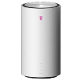 | Xiaomi 5G CPE Pro | CB0401 |
|  | Mi Router 4A Gigabit V2 | R4AV2 |
|  | Xiaomi Home WiFi | RB08 |
|  | Redmi Router AX6000 | RB06 |
| 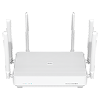 | Redmi Router AX5400 | RA74 |
|  | Redmi Gaming Router AX5400 | RB04 |
| 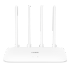 | Xiaomi Router AC1200 | RB02 |
|  | Xiaomi Router CR8808 | CR8808 |
| 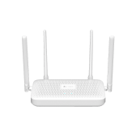 | Xiaomi Router CR8809 | CR8809 |
| — | Xiaomi Router CR8806 | CR8806 |
| 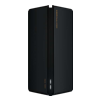 | Xiaomi Mesh System AX3000 | RA82 |
|  | Xiaomi Router AX3200 | RB01 |
| 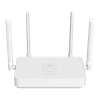 | Redmi Router AX1800 | RA71 |
|  | Redmi Router AX6S | RB03 |
|  | Xiaomi Router AX3000 | RA80 |
|  | Xiaomi Router AX3000 (V2) | RA80V2 |
|  | Redmi Router AX3000 | RA81 |
|  | Xiaomi China Unicom WiFi 6 Router | CR6606 |
| 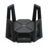 | Xiaomi Router AX9000 | RA70 |
| 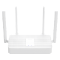 | Redmi Router AX5 | RA50 |
|  | Xiaomi Router AX6000 | RA72 |
| 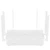 | Redmi Router AX6 | RA69 |
| 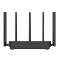 | Mi Router 4 Pro | R1350 |
| 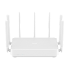 | Mi AIoT Router AC2350 | R2350 |
|  | Redmi Router AX5 | RA67 |
| 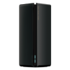 | Mi Router AX1800 | RM1800 |
| 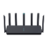 | Xiaomi AIoT Router AX3600 | R3600 |
| 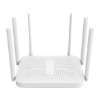 | Redmi Router AC2100 | RM2100 |
| 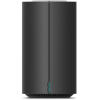 | Mi Router AC2100 | R2100 |
| 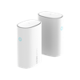 | Mi Router Mesh | D01 |
|  | Mi Router 4A | R4AC |
| 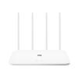 | Mi Router 4A Gigabit | R4A |
|  | Mi Router 4C | R4CM |
| 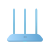 | Mi Router 4Q | R4C |
| 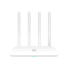 | Mi Router 4 | R4 |
| 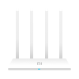 | Mi Router 3A | R3A |
|  | Mi Router 3C | R3L |
|  | Mi Router HD | R3D |
|  | Mi Router Pro | R3P |
| 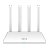 | Mi Router 3G | R3G |
|  | Mi Router 3 | R3 |
| 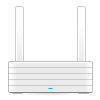 | Mi Router R2D | R2D |
|  | Mi Router Lite | R1CL |
| 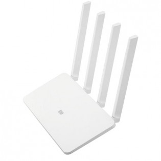 | Mi Router Mini | R1CM |
| 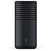 | Mi Router R1D | R1D |
|  | Xiaomi Mi Router BE3600 2.5G | RD15 |
| 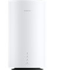 | Xiaomi 5G CPE Pro CB0401V2 | CB0401V2 |
| 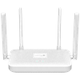 | Xiaomi Mi Router CR8816 | CR8816 |
| 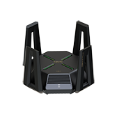 | Mi Router 10000 | RC01 |
| 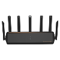 | Xiaomi Router BE7000 | RC06 |
|  | Xiaomi Router AX3000T | RD03 |
|  | Xiaomi Router BE6500 Pro | RD08 |
| 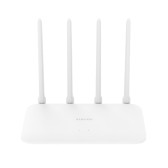 | Mi Router 4A (RD05) | RD05 |
|  | Xiaomi Router AX1500 | RD04 |
| 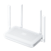 | Xiaomi Router AX1500 EU | RD12 |
| 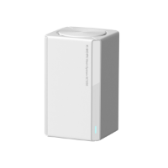 | Xiaomi Mesh System AC1200 | RD13 |
| 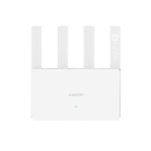 | Xiaomi BE3600 Gigabit | RD16 |
| 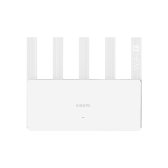 | Xiaomi Router BE5000 | RD18 |
| 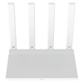 | Xiaomi Router AX3000T EU | RD23 |
| 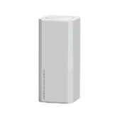 | Xiaomi Mesh AX3000 NE | RD28 |
|  | Xiaomi Router BE3600 Pro Black | RN01 |
| 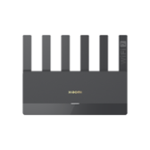 | Xiaomi Router BE6500 | RN02 |
| 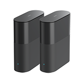 | Xiaomi Whole House BE3600 Pro Master | RN04 |
| 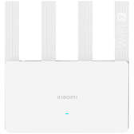 | Xiaomi Router BE3600 2.5G Global | RN06 |
| 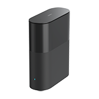 | Xiaomi Mesh System BE3600 Pro | RN09 |
| 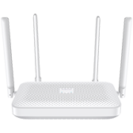 | Xiaomi Router AX1500 | RD04v2 |
| 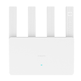 | Xiaomi Router AX3000T | RN07 |
| 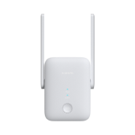 | Xiaomi Range Extender AX1500 | RN12 |
| 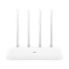 | Xiaomi 4A Gigabit Edition | R4ACv2 |
| 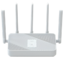 | Xiaomi Router AX3000 NE | RC02 |
| 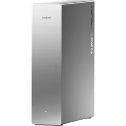 | Xiaomi BE10000 Pro | RP04 |
| 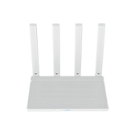 | Xiaomi Router AX3000T (Qualcomm version) | RD03V2 |
| 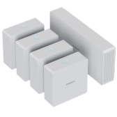 | Xiaomi Whole House Router BE3600 Pro Wired (5-port main router) | RP01 |
| 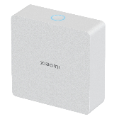 | Xiaomi Whole House Router BE3600 Pro Wired (satellite router) | RP03 |


### Check list


These endpoint names describe the stock MiWiFi API. Optional endpoints vary by
firmware; their absence does not by itself mean the router is unsupported.

#### Required
- `xqsystem/login` - Authorization;
- `xqsystem/init_info` - Basic information about the router;
- `misystem/status` - Basic information about the router. Diagnostic data, memory, temperature, etc;


#### Additional
- `xqnetwork/mode` / `xqnetwork/get_netmode` - Operating-mode detection with fallback between endpoints;
- `misystem/topo_graph` - Mesh topology used for discovery, router roles and client routing;
- `xqsystem/check_rom_update` - Getting information about a firmware update;
- `xqnetwork/wan_info` - WAN port information;
- `xqsystem/vpn_status` - Information about vpn connection;
- `misystem/led` - Interaction with LEDs;
- `xqnetwork/wifi_detail_all` - Getting information about WiFi adapters;
- `xqnetwork/wifi_diag_detail_all` - Getting information about guest WiFi;
- `xqnetwork/avaliable_channels` - Gets available channels for WiFi adapter;
- `xqnetwork/wifi_connect_devices` - Get information about connected devices;
- `misystem/devicelist` - More information about connected devices;
- `xqnetwork/wifiap_signal` - AP signal in repeater mode;
- `misystem/newstatus` - Additional information about connected devices for force load mode;
- `xqnetwork/macbind_info` - DHCP reservations;
- `xqnetwork/lan_dhcp` - LAN DHCP configuration used to validate reservations.


#### Action
- `xqsystem/reboot` - Reboot;
- `xqsystem/upgrade_rom` - Firmware update;
- `xqsystem/flash_permission` - Check permission to update the firmware;
- `xqnetwork/set_wifi` - Update WiFi settings. Causes the adapter to reboot;
- `xqnetwork/set_wifi_without_restart` - Update Guest WiFi settings;
- `xqnetwork/mac_bind` / `xqnetwork/mac_unbind` - Add/edit or remove a DHCP reservation, only on a verified firmware profile (see [DHCP reservations](#dhcp-reservations)).


If your model is not listed, you can try adding the integration. Capability checks
may disable features that the firmware does not provide. When reporting a problem,
include the model code, firmware, Home Assistant and integration versions, and the
relevant error message.


If setup reports `Router {ip} not supported`, include that message and the router's
model in a [new issue](https://github.com/JuanManuelRomeroGarcia/hass-miwifi/issues/new/choose).
For mesh routing or counter problems, follow the [support capture guide](https://github.com/JuanManuelRomeroGarcia/hass-miwifi/wiki/Mesh-support-capture)
and share only the anonymized `mesh_support` section publicly. The rest of a
diagnostics download can contain device and network information.

## Home Assistant compatibility

The declared HACS minimum remains **Home Assistant 2025.8.0**. Current automated
compatibility checks cover **2026.9.3** and **2026.10.0**, with the legacy suite also
required on 2026.10.0. Earlier versions are not covered by the current CI matrix;
this does not establish that they are incompatible. See the [test guide](tests/README.md)
and [test workflow](.github/workflows/tests.yml) for the environments being checked.

Use [Releases](https://github.com/JuanManuelRomeroGarcia/hass-miwifi/releases)
to check what has been published. Changes on `main` or in a pull request may still
be awaiting a release.

## DHCP reservations

Available from **v3.10.0** in the MiWiFi panel's **DHCP** page. Reservations belong
to the main router, including clients connected through mesh nodes. A single main
router is selected automatically; a selector appears only for multiple independent
networks. Mesh nodes cannot be selected for reservation operations.

Adding, editing and deleting reservations is enabled for the verified **BE10000 /
RC01 firmware 1.1.56** profile with DHCP enabled. Other firmware is read-only when
its API responses are compatible. Writes require a Home Assistant administrator.
Automatic private-MAC replacement does not move or delete DHCP reservations;
each reservation belongs to its configured MAC address.

Read the [DHCP guide](https://github.com/JuanManuelRomeroGarcia/hass-miwifi/wiki/DHCP-reservations)
([español](https://github.com/JuanManuelRomeroGarcia/hass-miwifi/wiki/DHCP-reservations-es)) for validation, refresh and lease behavior.

## Automatic replacement of private MAC addresses

Available from **v3.9.0**. Read the [project wiki guide](https://github.com/JuanManuelRomeroGarcia/hass-miwifi/wiki/Random-MAC-addresses) before enabling it. The guide covers aliases, deletion effects, troubleshooting and persistence.

Automatic replacement is opt-in. Configure only router names that uniquely identify one physical client in your network; aliases can include its previous and current router names:

Administrators can manage the saved client list in the MiWiFi panel under the main router's settings, in **Automatic MAC replacement**. Select a known client or add one manually, enter one router-name alias per line, and save. Existing rules are loaded before editing; removing a rule disables future replacements for that client. Saving does not reload the integration. The action below remains available for YAML configurations.

```yaml
action: miwifi.configure_mac_replacement
data:
  clients:
    watch:
      - SM-L315F
      - Reloj JuanMa
```

The configuration and known MACs persist across restarts. A verified rename on a known, connected MAC is learned as another alias. When every loaded node provides a fresh complete client list and exactly one associated MAC is online, MiWiFi removes the previous inactive MACs and their MiWiFi entities without waiting for the normal purge age limit. The currently connected MAC remains. Simultaneous online MACs, unknown activity flags, missing client names for a new MAC, and incomplete/stale node observations prevent replacement. Only integration-owned entities are removed; unrelated entities preserve their device row. A router rename and a MAC change at the same time need an explicitly configured alias, because there is no reliable identity linking the new name to the old MAC.

Set `clients: {}` through the same action to disable automatic replacement. Previously purged MACs remain suppressed until a real connection is reported. Standard inactivity purging remains available for other clients.

Replacement deletes the old MAC's MiWiFi client entities; it does **not** migrate entity/device IDs, areas, custom labels, person assignments or automation references to the new MAC. Review references to the deleted tracker. When saving a rule, unavailable MiWiFi clients retained only in HA's registries are also matched using integration-provided names and MAC identifiers. User display-name overrides do not establish identity.

## Integrated frontend panel

As of version **v3.7.0**, the MiWiFi frontend panel is included in this integration and is automatically installed via HACS. There is no need to install a separate panel or manually add resources.

The standalone [miwifi-panel-frontend](https://github.com/JuanManuelRomeroGarcia/miwifi-panel-frontend) repository remains for historical reference regarding older installations; new installations should use this repository.

The panel includes translations for English, Spanish, German, French, Brazilian
Portuguese, Russian, Turkish and Simplified Chinese.

## Support the project

MiWiFi is free to use. If it helps you, you can support its development with a
voluntary donation via [PayPal](https://www.paypal.com/donate/?hosted_button_id=UTTD853CXYX8G)
or [Wise](https://wise.com/pay/me/juanmanuelr175). Donations are optional; all
features remain available without contributing. Bug reports, translations and
feedback are also welcome.
